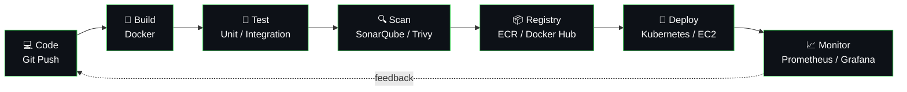

<!-- Replace every USERNAME, LINKEDIN and [bracketed] placeholder before committing -->


<p align="center">
  
</p>

<p align="center">
  <a href="https://linkedin.com/in/LINKEDIN"></a>
  <a href="mailto:Shaikhmaaz8788@gmail.com"></a>
  
</p>

---

## 🖥️ `$ whoami`

```console
maaz@devops:~$ whoami
Maaz Javed Shaikh

maaz@devops:~$ cat role.txt
DevOps Engineer | 4+ years | Cloud, CI/CD, Infrastructure Automation

maaz@devops:~$ cat status.txt
Open to Work: DevOps / Cloud / SRE / Platform Engineering

maaz@devops:~$ ls ~/achievements
tiaa-hackathon-top5/   gdg-member-2023-2024/   multiple-hackathons/

maaz@devops:~$ cat contact.txt
Shaikhmaaz8788@gmail.com
```

DevOps Engineer with **4+ years** of hands-on experience building and operating cloud infrastructure, automating deployments, and shipping reliable CI/CD pipelines for production systems. I enjoy turning manual, error-prone processes into repeatable, observable and secure automation.

- 🔭 Worked on: **Infra Konnect (NumberTree, Mumbai)**, **UAE Logistics ERP**, **Cloud CI/CD pipelines**
- 🏆 **Top 5** at the TIAA hackathon, and a participant in multiple hackathons
- 👥 Former **Google Developer Group (GDG)** member (2023–2024)

---

## 🔄 How I Ship: CI/CD Pipeline

<!-- Edit the tool names in each box to match your real pipeline -->



---

## 🛠️ Tech Stack

<!-- Keep ONLY the tools you have really used. Delete the rest. -->

### ☁️ Cloud


### 🏗️ Infrastructure as Code


### 🐳 Containers & Orchestration


### 🔄 CI/CD & Version Control


### 📈 Monitoring & Observability


### 🔐 Security


### 💻 Scripting & OS


---

## 💼 Experience

| Role | Company | Duration |
|------|---------|----------|
| **DevOps Engineer** | AM Infoweb | Mar 2026 – Nov 2026 |
| **DevOps Engineer** | Jazar Technology | Jan 2025 – Feb 2026 |
| **DevOps Engineer** *(Part-time)* | Oscar Technologies | Feb 2021 – Nov 2024 |

<!-- Fix the role titles above if they were different (e.g. Cloud Engineer, SysAdmin, Intern) -->

**What I did across these roles** *(edit to match your real work)*:
- Built and maintained CI/CD pipelines for automated build, test and deployment
- Provisioned and managed cloud infrastructure using Infrastructure as Code
- Containerised applications and managed deployments with Docker
- Set up monitoring, logging and alerting for production systems
- Managed Linux servers, access, backups and security hardening

---

## 🚀 Featured Projects

### 🏢 Infra Konnect — NumberTree, Mumbai
Infrastructure and deployment setup for the Infra Konnect platform.
`[Add your stack: AWS / Docker / CI-CD / Nginx ...]`

### 🚚 UAE Logistics ERP System
Cloud deployment and automation for a logistics ERP serving operations in the UAE.
`[Add your stack: ...]`

### ☁️ [Cloud CI/CD Pipeline Project — give it a name]
End-to-end CI/CD pipeline on the cloud: code commit → build → test → containerise → deploy.
`[Add your stack: GitHub Actions / Docker / AWS / Terraform ...]`
[🔗 Repo link](https://github.com/USERNAME/REPO-NAME)

---

## 🏆 Hackathons & Community

- 🥇 **Top 5 finalist**: TIAA company hackathon
- 💡 Participated in **multiple hackathons**
- 👥 **Google Developer Group (GDG)** member, 2023–2024

---

## 📊 GitHub Stats

<p align="center">
  
  
</p>

<p align="center">
  
</p>

<p align="center">
  
</p>

---

## 🐍 Contribution Snake

<p align="center">
  
</p>

---

<p align="center">
  <i>"Automate the boring stuff, monitor the important stuff, and always have a rollback plan."</i>
</p>


